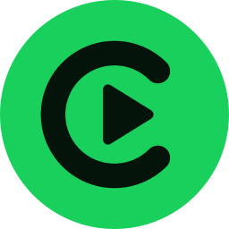
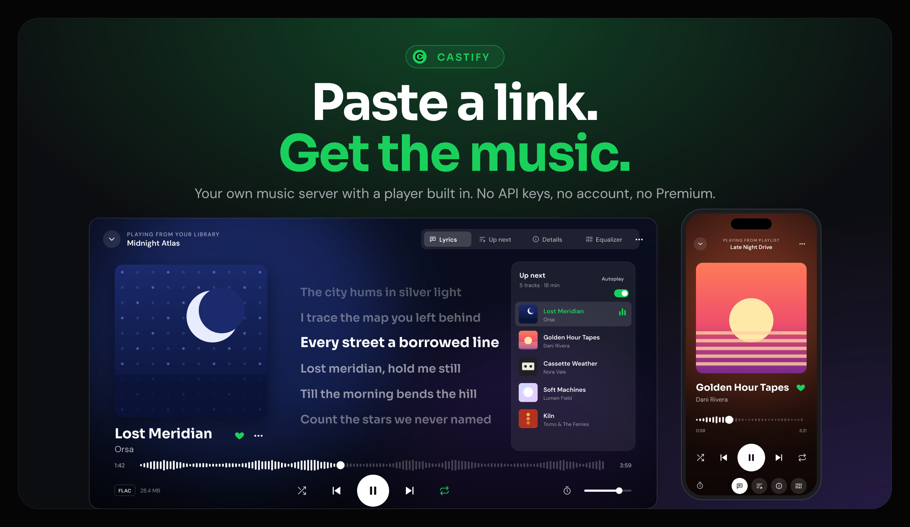

<p align="center"></p>
<h1 align="center">Castify</h1>

<p align="center">Your own music server. Paste a link, get a perfectly tagged song, <br> and play it back with synced lyrics. No API keys, no account, no Premium.</p>

<p align="center">
  <a href="https://downtify.henriquesebastiao.com/getting-started/installation/">Install</a> •
  <a href="https://downtify.henriquesebastiao.com/">Documentation</a> •
  <a href="https://downtify.henriquesebastiao.com/features/">Features</a> •
  <a href="https://downtify.henriquesebastiao.com/changelog/">Changelog</a> •
  <a href="https://github.com/henriquesebastiao/downtify-android">Android app</a>
</p>

<div align="center">

[](https://github.com/henriquesebastiao/downtify/actions/workflows/test.yml)
[](https://github.com/henriquesebastiao/downtify/releases)
[](/LICENSE)
[](https://github.com/henriquesebastiao/downtify/pkgs/container/downtify)

</div>

<p align="center">
  
</p>

## Overview

Castify is a self-hosted web app that turns Spotify, YouTube Music, Deezer and SoundCloud links into a tagged audio library, then plays that library back: a full-screen player with synced lyrics, an editable queue and autoplay, from your browser or your phone. It never touches the Spotify API and needs no account or Premium subscription.

```
Spotify embed page  →  YouTube Music search  →  yt-dlp + ffmpeg + mutagen
   (metadata)             (audio match)            (download & tag)
```

Metadata comes from the public `open.spotify.com/embed` pages, the audio from the closest YouTube Music match (standard YouTube when there is none), and every file gets its title, artists, album, year, cover art and lyrics embedded. Everything runs in a single Docker container. See **[How it works](https://downtify.henriquesebastiao.com/how-it-works/)** for the full pipeline.

> [!NOTE]
> Castify was called **Downtify** before. Only the name and logo changed: the `DOWNTIFY_*` environment variables, the Docker image, the `/data` files and the liked-songs playlist (`Downtify Liked Songs.m3u`) keep their old names, so an existing install keeps working as is.

## Features

| | |
| --- | --- |
| **Download** | Tracks, albums, playlists and artists from Spotify, YouTube Music, Deezer and SoundCloud, free-text search and CSV imports. MP3, FLAC, M4A, OGG or OPUS, or the source audio untouched; songs you stream often can download themselves. [Download settings](https://downtify.henriquesebastiao.com/features/download-settings/) |
| **Player** | Full-screen Now playing with synced lyrics, Up next, autoplay when the queue runs out, a sleep timer, an equalizer and media keys. Songs fade into each other or play gapless, and the next songs' lyrics load ahead so they're there the moment a song starts. What plays on your other devices shows up with **Listen here** to pick it up. [Built-in player](https://downtify.henriquesebastiao.com/features/player/) |
| **Jam** | Listen together: friends with an account on your server join with a code, add songs to one shared queue and hear the same song at the same moment on their own devices. [Jam](https://downtify.henriquesebastiao.com/features/jam/) |
| **Home & playlists** | A Home laid out like a streaming app, daily mixes, and your own playlists that accept any song, downloaded or not, with suggestions that fit each one. [Building playlists](https://downtify.henriquesebastiao.com/features/building-playlists/) |
| **Library** | Albums, artists, playlists and tracks with filters, sorting and ZIP export. Import folders you already have, repair small covers and missing lyrics, replace a wrongly matched song, fix a song's info from Apple Music, Deezer or YouTube Music. [Library catalog](https://downtify.henriquesebastiao.com/features/library-catalog/) |
| **Tags and lyrics** | Cover art, every credited artist and the explicit mark in each file; plain and synced lyrics from LRCLIB and NetEase. [Lyrics](https://downtify.henriquesebastiao.com/features/lyrics/) |
| **Discover & charts** | Artists, albums and playlists you don't have yet, from your library and what you play, plus Deezer's charts — all playable in full before you download. [Discover](https://downtify.henriquesebastiao.com/features/discover/) |
| **Playlist Monitor** | Watch playlists and artists; new songs and releases download on your schedule. [Playlist Monitor](https://downtify.henriquesebastiao.com/features/playlist-monitor/) |
| **Users** | Accounts for the whole house (and OpenID Connect), a shared library admins can hide things from, per-account likes, shareable playlists and public links to a song that play without an account, or a story picture of it with a QR code ([Sharing a song](https://downtify.henriquesebastiao.com/features/song-links/)). [Users & sign-in](https://downtify.henriquesebastiao.com/features/users/) |
| **Mobile** _(experimental)_ | Sign a phone in, stream the library in full or transcoded quality, keep songs offline. [Mobile apps](https://downtify.henriquesebastiao.com/features/mobile-apps/) |
| **Media servers** | M3U playlists with covers for Jellyfin, Navidrome and Plex, optional Soulseek downloads through slskd and Navidrome playlist sync. [slskd & Navidrome](https://downtify.henriquesebastiao.com/features/slskd-navidrome/) |
| **Admin tools** | Storage & usage, a 30-day music trash, a pausable download queue shared fairly between accounts, library-only mode, an outbound proxy and download exclusions — and a one-tap **User view** to see the app as a user does. [All features](https://downtify.henriquesebastiao.com/features/) |
| **Interface** | Light and dark themes, phone to widescreen, installable as an app ([PWA](https://downtify.henriquesebastiao.com/features/pwa/)) that keeps playlists and albums on the device to play offline ([Offline listening](https://downtify.henriquesebastiao.com/features/offline/)), eleven languages, French by default. |

## Quick start

You only need [Docker](https://docs.docker.com/get-docker/).

```bash
docker run -d -p 8000:8000 --name downtify \
  -v /path/to/downloads:/downloads \
  -v downtify_data:/data \
  ghcr.io/henriquesebastiao/downtify
```

Open [http://localhost:8000](http://localhost:8000), sign in as **`admin`** / **`downtify`**, change that password in **Settings → General**, then paste a link. `/downloads` holds your music and `/data` the database and settings: keep both persistent.

### Docker Compose

```yaml
services:
  downtify:
    container_name: downtify
    image: ghcr.io/henriquesebastiao/downtify:latest
    ports:
      - '8000:8000'
    volumes:
      - ./downloads:/downloads
      - downtify_data:/data
    restart: unless-stopped

volumes:
  downtify_data:
```

Another port, the timezone, cookies or IPv4 are set with **[environment variables](https://downtify.henriquesebastiao.com/getting-started/environment-variables/)**; everything else lives in **Settings**. One-click installs exist for [Umbrel](https://apps.umbrel.com/app/downtify), [CasaOS](https://casaos.zimaspace.com/) and [HomeDock OS](https://www.homedock.cloud/apps/downtify/).

## What you can paste in

| Input | Example |
| --- | --- |
| Spotify track, album, playlist or artist | `open.spotify.com/track/…` |
| YouTube Music playlist or artist | `music.youtube.com/playlist?list=…` |
| YouTube or YouTube Music video | `youtube.com/watch?v=…` |
| Deezer track, album, playlist or artist | `deezer.com/track/…` |
| SoundCloud track | `soundcloud.com/artist/track` |
| Free-text search | `The Night Owls Do I Still Recall` |
| Library export (CSV) | Soundiiz, TuneMyMusic, Exportify |

## Castify for Android

An Android app is in development: it signs in to your server, plays the library in original or mobile-data quality, keeps songs offline and casts to a Chromecast. **No version is published yet**, which is why **Settings → Apps** is marked experimental. Repository: **[henriquesebastiao/downtify-android](https://github.com/henriquesebastiao/downtify-android)** — anything else can be built against the [mobile client contract](https://downtify.henriquesebastiao.com/mobile-client-contract/).

## Troubleshooting

Most download problems mean YouTube wants a signed-in session: upload a `cookies.txt` in **Settings → YouTube cookies**. See **[Troubleshooting](https://downtify.henriquesebastiao.com/troubleshooting/)** for the rest.

## Translations

The app speaks English, French, Spanish, Brazilian Portuguese, Turkish, Hungarian, Greek, Bulgarian, German, Korean and Simplified Chinese (switch in **Settings → Language**), and the documentation follows the same languages. Adding one is a small change: see **[Internationalization](https://downtify.henriquesebastiao.com/features/internationalization/)**.

## Documentation

| | |
| --- | --- |
| [Getting started](https://downtify.henriquesebastiao.com/getting-started/) | Installation, Docker Compose, one-click installs, environment variables |
| [Features](https://downtify.henriquesebastiao.com/features/) | One page per feature, every option explained |
| [How it works](https://downtify.henriquesebastiao.com/how-it-works/) | The metadata, matching and tagging pipeline |
| [API reference](https://downtify.henriquesebastiao.com/api-reference/) | Every endpoint the web interface uses |
| [Changelog](https://downtify.henriquesebastiao.com/changelog/) | What changed in each release |

## Contributing

Issues and pull requests are welcome. Read [**CONTRIBUTING.md**](./CONTRIBUTING.md) first: local setup, Ruff and Prettier, tests and the pull request checklist.

[](https://github.com/henriquesebastiao/downtify/graphs/contributors)

If Castify is useful to you, a star helps other people find it, and you can [buy the original author a coffee](https://www.buymeacoffee.com/henriquesebastiao).

## License

[AGPL-3.0](https://github.com/henriquesebastiao/downtify?tab=AGPL-3.0-1-ov-file#readme). Icons by [Font Awesome](https://fontawesome.com) (Free, [CC BY 4.0](https://fontawesome.com/license/free)).

> [!WARNING]
> Users are responsible for their actions and any legal consequences. Castify does not support unauthorized downloading of copyrighted material and takes no responsibility for user actions.
